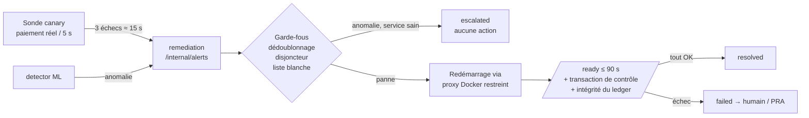
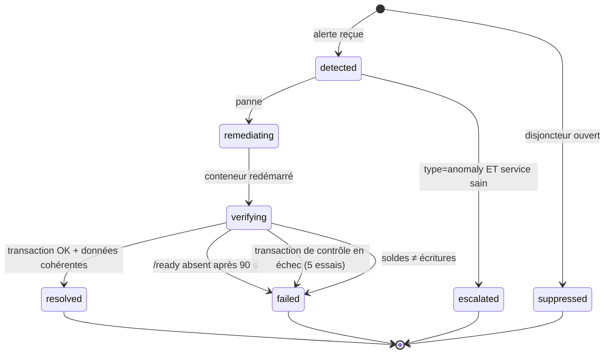
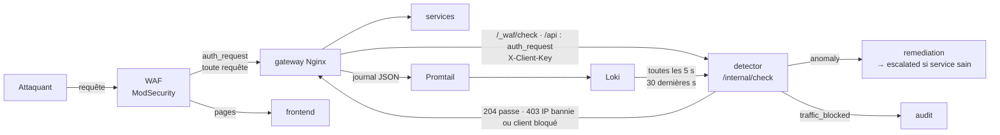

# RESILIENCE-ALPHA — Reprise sur erreur, idempotence et détection ML

Ce document explique comment la plateforme se comporte quand quelque chose casse, pourquoi un paiement n'est
jamais exécuté deux fois, et comment entraîner puis brancher un **Isolation Forest** qui détecte le trafic
d'attaque en temps réel et le bloque à la passerelle.

Référence des tables et des API : `docs/01-donnees-et-services.md`. Les comportements décrits ont été vérifiés
sur la pile réelle le 2026-10-19 (pannes provoquées avec `docker stop`, attaques simulées avec `ml/traffic.py`).

## Sommaire

1. [Reprise en cas d'erreur](#1-reprise-en-cas-derreur)
2. [Idempotence, service par service](#2-idempotence-service-par-service)
3. [Détection ML (Isolation Forest) et blocage des attaquants](#3-détection-ml-isolation-forest-et-blocage-des-attaquants)
   — 3.1 IP réelle, 3.6 comparaison des modèles, 3.7 le ML suffit-il ?, 3.8 détection actuelle, 3.10 pilotage,
   3.13 alertes Discord, 3.14 WAF et liste des bans

---

## 1. Reprise en cas d'erreur

### 1.1 Le principe : détecter, décider, agir, **prouver**

Un conteneur qui redémarre ne prouve rien. La plateforme considère un incident clos seulement quand une
**nouvelle transaction réelle réussit** et que les **données sont cohérentes**.



### 1.2 Mécanismes de reprise, couche par couche

| Couche | Mécanisme | Effet |
|---|---|---|
| Démarrage | `depends_on: postgres (healthy)` ; pool asyncpg : 30 tentatives × 1 s | Un service démarré avant la base attend au lieu de planter |
| Santé | `HEALTHCHECK` Docker sur `/ready` toutes les 5 s (la base doit répondre) | `docker compose ps` et la sonde voient un service sans base comme indisponible |
| Passerelle | Résolution DNS dynamique (5 s), délais 2 s / 10 s | Un service redémarré est retrouvé sans recharger Nginx ; un service arrêté donne 502, pas un blocage |
| Appels internes | Délais courts (2 à 5 s) ; jetons de service de 60 s recréés à chaque appel | Une panne d'un service ne bloque pas indéfiniment ses appelants |
| Événements | `audit()` / `notify()` asynchrones « au mieux » | Audit ou notifications en panne ⇒ le paiement réussit quand même (`event_delivery_failed` journalisé) |
| Paiements | État `pending` + 503 + **réconciliateur** (15 s) | Ledger en panne ⇒ la demande est conservée et réglée automatiquement au retour, sans double débit |
| Détection | Sonde : 3 échecs consécutifs (~15 s) ; détecteur ML (section 3) | Alerte vers la remédiation |
| Action | Remédiation : redémarrage du conteneur via un proxy qui n'autorise que stop/restart/kill | Aucun service ne possède le socket Docker |
| Preuve | `/ready` + transaction de contrôle (5 essais) + `/internal/integrity` | `resolved` seulement si le service est réellement utilisable et les soldes justes |
| Politique Docker | `restart: "no"` sur les 4 services métier ; `unless-stopped` sur le reste | La reprise des services métier est l'œuvre du moteur, donc démontrable |

### 1.3 Le moteur de remédiation en détail

**États d'un incident**



**Garde-fous**

| Garde-fou | Règle | Pourquoi |
|---|---|---|
| Émetteurs autorisés | Seuls `canary` et `detector` (jeton de service) peuvent alerter | Un service compromis ne peut pas déclencher de redémarrages |
| Liste blanche | `rsl-auth`, `rsl-accounts`, `rsl-payments`, `rsl-notifications` uniquement | Jamais PostgreSQL, ni le moteur lui-même, ni le proxy |
| Dédoublonnage | Un seul incident actif par service | Les alertes répétées pendant une reprise ne relancent rien |
| Disjoncteur | 3 remédiations par service en 10 min, ensuite `suppressed` + audit | Évite les boucles de redémarrage ; limite l'effet d'une alerte forgée |
| Anomalie ≠ panne | `anomaly` sur un service sain ⇒ `escalated`, **aucune action** | Une compromission ne se corrige pas en redémarrant ; redémarrer effacerait les preuves |
| Proxy Docker | `POST=1, ALLOW_RESTARTS=1, CONTAINERS=0` : seuls `stop|restart|kill` passent | Vérifié : liste et création de conteneurs refusées (403), redémarrage accepté (204) |

### 1.4 Que se passe-t-il quand… (matrice de pannes)

| Composant en panne | Ce que voient les clients | Détection | Reprise | Données |
|---|---|---|---|---|
| **payments** | 502 sur `/api/payments` (le front propose « Réessayer » avec la même clé) | Sonde : paiement en échec, `/ready` payments KO | Redémarrage par la remédiation | Rien de perdu : les paiements déjà enregistrés sont en base |
| **accounts** (ledger) | Création de paiement : **503 `pending`**, puis passage à `completed` tout seul | Sonde | Redémarrage, puis le réconciliateur règle les `pending` (≤ 15 s) | Aucun double débit (idempotence du transfert) |
| **auth** | Connexion et inscription impossibles (502). Les sessions ouvertes **continuent** (JWT vérifiés localement) | `/ready` auth KO, mais la sonde ne voit l'échec qu'au renouvellement de son jeton : **jusqu'à ~14 min** (limite, 1.7) | Redémarrage dès que la sonde alerte (ou le détecteur) | Compteurs anti-force brute remis à zéro |
| **notifications** | Paiements OK ; notifications manquantes pendant la panne | `/ready` KO mais **la sonde n'alerte pas** (paiement réussi) — limite, 1.7 | Pas de remédiation automatique aujourd'hui | Notifications de la période **perdues** (envoi au mieux, sans file) |
| **audit** | Rien de visible | Logs `event_delivery_failed` | `restart: unless-stopped` (si le processus meurt) | Événements de la période **perdus** (au mieux) |
| **PostgreSQL** | Tous les services `/ready` = 503 ; erreurs 500/503 | Sonde (tous les services KO) | **Hors remédiation** (jamais redémarré par le moteur) : `unless-stopped`, sinon humain | Volume `pgdata` ; restauration = PRA |
| **gateway** | Plateforme injoignable | Sonde (elle passe par la passerelle) | `unless-stopped` | – |
| **remediation** | Rien ; plus de reprise automatique | Grafana (`up` = 0) | `unless-stopped` | Historique en mémoire perdu (l'audit le conserve) |
| **canary** | Rien ; plus de preuve ni d'alerte de secours | Grafana | `unless-stopped` | – |
| **detector** (option) | Rien : la passerelle laisse passer (ouverture par défaut) | Grafana (`up` = 0) | `unless-stopped` | Liste de blocage en mémoire perdue |
| Prometheus / Loki / Grafana | Rien | – | `unless-stopped` | Métriques et logs non persistés (`down` les efface) |

### 1.5 Durées mesurées (pile réelle, 2026-10-19)

| Scénario | Mesure |
|---|---|
| `docker stop rsl-payments` → service de nouveau opérationnel | 25 à 34 s (détection ~15 s + redémarrage + preuve) |
| Durée « alerte → reprise prouvée » (`remediation_recovery_seconds`) | 2,5 à 4,6 s pour payments et accounts |
| `docker stop rsl-accounts` pendant un paiement → paiement `completed` sans action | ~70 s (détection, reprise, puis cycle du réconciliateur) |

### 1.6 Deux défauts corrigés le 2026-10-19 (la reprise ne fonctionnait pas avant)

1. **Chaque alerte faisait planter le moteur** : `TypeError: audit() got multiple values for argument 'service'`
   (le moteur passe `service=` dans les détails d'audit). L'incident restait « actif » et toutes les alertes
   suivantes étaient dédoublonnées : aucun redémarrage n'avait jamais lieu. Correctif : paramètres positionnels
   uniquement dans `events.audit()` / `notify()` + test de non-régression.
2. **Le proxy Docker refusait tous les redémarrages (403)** : avec `POST=0`, HAProxy rejette tout non-GET avant
   d'appliquer `ALLOW_RESTARTS`. Correctif : `POST=1, ALLOW_RESTARTS=1, CONTAINERS=0`.

### 1.7 Limites connues et pistes

| Limite | Conséquence | Piste |
|---|---|---|
| La sonde réutilise son jeton ~14,5 min | Une panne d'**auth** n'est pas détectée avant l'expiration du jeton | Faire échouer la sonde dès qu'un `/ready` est KO, ou se reconnecter à chaque sonde |
| La sonde n'échoue pas quand **notifications** tombe | Pas de remédiation automatique de notifications | Alerter sur `ready=false` même si la transaction réussit |
| Disjoncteur partagé | 3 échecs (ou escalades d'anomalie) en 10 min ⇒ la panne suivante est `suppressed` | Ne compter que les redémarrages effectifs ; plafond séparé pour les anomalies |
| Incidents en mémoire | Perdus si le moteur redémarre | Persister (table dédiée) ; l'audit garde déjà la trace |
| Événements « au mieux » | Audit et notifications perdus pendant leur panne | File d'attente (outbox) avec rejeu idempotent |
| PostgreSQL unique | Point de défaillance unique | Réplication + sauvegardes testées (PRA) |

---

## 2. Idempotence, service par service

**Définition** : une opération est idempotente si l'exécuter plusieurs fois a le même effet que l'exécuter une
fois. C'est ce qui permet de **réessayer sans risque** après une erreur réseau, un 502 ou un délai dépassé —
exactement ce qui arrive pendant une panne.

### 2.1 Vue d'ensemble

| Service · opération | Idempotent ? | Mécanisme | Si on rejoue |
|---|---|---|---|
| **payments** · `POST /api/payments` | **Oui** | `Idempotency-Key` + `UNIQUE(created_by, idempotency_key)` | Même paiement renvoyé (200), aucun nouveau débit ; 409 si le contenu diffère |
| **accounts** · `POST /internal/transfer` | **Oui** | `tx_id` = id du paiement ; test préalable + `UNIQUE(tx_id, account_id, direction)` | `already_applied`, aucun mouvement |
| payments · réconciliateur | **Oui** | Rejoue le transfert avec le même `tx_id` ; passage d'état conditionnel `WHERE status='pending'` | Un paiement n'est réglé qu'une fois, même en concurrence avec la requête initiale |
| auth · `POST /api/auth/register` | Non, mais **sans danger** | `UNIQUE(username)` | 2ᵉ essai ⇒ 409 (le compte existe déjà) |
| auth · `POST /api/auth/login` | Oui (lecture) | – | Un nouveau jeton à chaque fois ; un échec compte dans l'anti-force brute |
| **accounts** · `POST /api/accounts` | **Non** | – | **Un compte de plus** (avec un nouveau crédit de démonstration) |
| notifications · `POST /internal/events` | Non | – | Notification en double (aujourd'hui l'émetteur ne rejoue jamais) |
| audit · `POST /internal/events` | Non (ajout seul) | – | Événement en double, chaîne toujours valide (l'émetteur ne rejoue jamais) |
| remediation · `POST /internal/alerts` | Partiellement | Un incident actif par service | Pendant une reprise : dédoublonné ; après : nouvel incident (borné par le disjoncteur) |
| Tous les `GET` | Oui | Lecture seule | – |

### 2.2 Le paiement, de bout en bout

```mermaid
sequenceDiagram
    participant C as Client (front)
    participant P as payments
    participant A as accounts (ledger)
    C->>P: POST /api/payments  Idempotency-Key: K
    P->>P: INSERT pending ON CONFLICT (created_by, K) DO NOTHING
    alt clé déjà vue
        P->>P: relit le paiement ; contenu différent ⇒ 409
    end
    P->>A: POST /internal/transfer  tx_id = payment.id
    alt écritures déjà présentes pour tx_id
        A-->>P: already_applied (rien n'est débité)
    else
        A->>A: verrous (ordre fixe), contrôles, débit + crédit + 2 écritures (1 transaction)
        A-->>P: applied
    end
    P->>P: UPDATE … SET completed WHERE status = 'pending'
    P-->>C: 201 (ou 200 si rejeu)
    Note over P,A: Ledger injoignable ⇒ reste pending, 503 + Retry-After.<br/>Le réconciliateur rejoue toutes les 15 s avec le même tx_id.
```

**Pourquoi aucun double débit n'est possible, même dans les cas tordus**

| Situation | Ce qui protège |
|---|---|
| Le client renvoie la même requête (double clic, réseau coupé avant la réponse) | `UNIQUE(created_by, idempotency_key)` : une seule ligne de paiement |
| Deux requêtes identiques arrivent **en même temps** | `ON CONFLICT DO NOTHING` : une seule insère, l'autre relit ; les deux appellent le ledger avec le même `tx_id` ⇒ une seule application |
| Le ledger a appliqué le transfert mais la réponse est perdue | Le paiement reste `pending` ; le rejeu (client ou réconciliateur) reçoit `already_applied` ⇒ `completed` |
| Requête initiale et réconciliateur en concurrence | Ledger : `UNIQUE(tx_id, account_id, direction)` ; payments : `UPDATE … WHERE status='pending'` (un seul gagnant) |
| Transferts croisés A→B et B→A simultanés | Verrous pris dans l'ordre des identifiants : pas d'interblocage |

**Côté front** (`frontend/src/app/(app)/payments/new`) : une clé générée par **intention** de paiement, affichée
à l'étape de vérification, **conservée** sur erreur transitoire (502, délai, réseau : « Réessayer » sans risque),
**renouvelée** si l'utilisateur modifie un champ ou après un refus métier (nouvelle intention).

**Écart connu** : le contrôle « même clé, contenu différent » compare comptes et montant, pas la devise.

### 2.3 Recommandations

1. **Ouverture de compte** : accepter un `Idempotency-Key` (même modèle que les paiements), sinon un double clic
   crée deux comptes et deux crédits de démonstration.
2. **Événements** : ajouter un `event_id` fourni par l'émetteur + contrainte d'unicité, préalable à toute file de
   rejeu (outbox) pour ne plus perdre audit et notifications pendant une panne.
3. **Remédiation** : clé d'alerte (`source + service + fenêtre`) pour dédoublonner aussi après la clôture.

---

## 3. Détection ML (Isolation Forest) et blocage des attaquants

Code : dossier `ml/` (voir `ml/README.md`). Tout ce qui suit a été exécuté sur la pile réelle le 2026-10-19 ;
les chiffres sont ceux mesurés, pas des objectifs.

### 3.1 L'IP réelle de l'attaquant : masquée par Docker Desktop, rendue par le relais de l'hôte

**Le problème** (mesuré le 2026-10-19) : une requête envoyée à `http://192.168.1.49:8080` (adresse réseau du PC
Hôte) et une autre à `http://localhost:8080` arrivaient **toutes deux** avec la même adresse dans le conteneur.
**Docker Desktop (Windows/macOS) remplace l'adresse source** des connexions vers un port publié. Conséquences sans
correctif :

| Mécanisme « par IP » | Ce qu'il fait réellement sous Docker Desktop |
|---|---|
| Limites de débit (WAF 20 req/s, connexion 10/min) | **Une seule limite pour tous les clients extérieurs** |
| Anti-force brute d'auth (5 échecs/min/IP) | Une force brute **bloque la connexion de tout le monde** pendant 60 s |
| Bannir « l'IP de l'attaquant » | Bannirait tous les utilisateurs (d'où le refus des adresses partagées, 3.14) |

**La solution en place** : un relais sur le PC Hôte, `scripts/edge_relay.py`, lancé par `scripts/start.ps1` quand
`EDGE_RELAY=true` dans `.env`. Il écoute 8080 et 8443 sur le réseau, annonce l'adresse du client en tête de
connexion (**PROXY protocol**), puis relaie les octets tels quels vers des ports du WAF publiés en local
(`127.0.0.1:18080` et `18443`). Le TLS reste terminé par le WAF : le relais ne voit jamais le contenu chiffré.

```
PC Attaquant 192.168.137.25 ──► relais (hôte, :8443) ──PROXY 192.168.137.25──► WAF :8444 ──X-Forwarded-For──► passerelle ──X-Real-IP──► services
```

Chaque maillon ne croit que l'adresse fixe du précédent : le WAF n'accepte l'en-tête PROXY que de l'hôte vu par
Docker (`10.250.0.1`) sur ses ports relais ; la passerelle n'accepte `X-Forwarded-For` que du WAF (`10.250.0.5`),
qui le **remplace** (jamais complété) par l'adresse qu'il a vue. Un client ne peut donc pas usurper une autre IP en
envoyant lui-même ces en-têtes.

Vérifié le 2026-10-20 : une requête vers `https://192.168.1.49:8443` est vue en `192.168.1.49` par le WAF, la
passerelle et le service auth ; limites, anti-force brute, journaux, modèle ML et liste des bans travaillent tous
sur l'IP réelle. Vérification rapide après une requête du PC Attaquant : Grafana « WAF et bans », tableau « Clients
les plus actifs », ou `docker logs rsl-waf --tail 5`.

Sans relais (`EDGE_RELAY=false`, par exemple sous Linux où il est inutile : Docker Engine conserve l'adresse
source), le WAF publie directement 8080 et 8443. Sous Docker Desktop sans relais, tous les clients extérieurs ont
alors l'adresse `10.250.0.1` : le détecteur se rabat sur la clé `IP|User-Agent` (contournable en changeant d'agent)
et aucune IP ne peut être bannie. Le pare-feu Windows demande, au premier lancement du relais, d'autoriser `python`
sur les réseaux privés : accepter, sinon les autres postes ne joignent plus la plateforme.

### 3.2 Pourquoi un Isolation Forest (et pourquoi il ne suffit pas seul)

L'**Isolation Forest** est non supervisé : il apprend ce qui est *habituel* sans exemples d'attaques étiquetés,
puis isole les points qui sortent de cette norme (peu de coupes aléatoires suffisent à les séparer). C'est adapté
ici : on dispose de beaucoup de trafic normal (la sonde, les utilisateurs) et d'aucune base d'attaques.

Sa limite, constatée lors des essais : un arbre ne peut couper que sur une variable qui **varie** dans les données
d'entraînement. Dans le trafic normal, la part de 404, la part de requêtes hors `/api` et la part de 5xx valent
toujours 0 : la forêt ne sait rien de ces dimensions, et un balayage (100 % de 404) n'obtient qu'un score
« bord de distribution ». D'où le **complément par garde-fous de bornes** : à l'entraînement, chaque variable
reçoit une limite haute = maximum normal + max(50 % de l'étendue, plancher) ; une fenêtre qui dépasse une limite
est anormale, quel que soit le score de la forêt. Le motif est enregistré (`exceeded`) pour l'analyste.

### 3.3 Données et variables

Source : le journal d'accès JSON de la passerelle (point d'entrée unique), collecté par Promtail dans Loki :
`remote_addr`, `method`, `uri`, `status`, `request_time`, `upstream_time`, `bytes_sent`, `user_agent`,
`request_id`. Le trafic est découpé en **fenêtres de 30 s par client** (`IP|User-Agent`).

| Variable | Calcul | Ce qu'elle trahit |
|---|---|---|
| `log_requests` | log(1 + nb de requêtes) | Inondation, outils automatiques |
| `distinct_routes` | nb de gabarits de route distincts (UUID → `{id}`) | Balayage, exploration |
| `frac_4xx`, `frac_5xx` | part des réponses 4xx / 5xx | Requêtes invalides, provocation d'erreurs |
| `frac_401`, `frac_404`, `frac_429` | parts de 401, 404, 429 | Devinette de jetons, énumération, limites atteintes |
| `log_logins` | log(1 + nb de `POST /api/auth/login`) | Force brute, bourrage d'identifiants |
| `frac_post` | part de POST | Écriture massive |
| `frac_outside_api` | part de chemins hors `/api/` | Recherche de pages d'admin, `/.env`, `/internal` |
| `mean_request_time`, `max_request_time` | temps de traitement (s) | Requêtes coûteuses, déni de service applicatif |
| `log_mean_bytes` | log(1 + octets moyens renvoyés) | Exfiltration (grosses réponses) |
| `log_payment_posts` | log(1 + nb de `POST /api/payments`) | Rafale de paiements |

### 3.4 Entraîner le modèle, pas à pas

**Le modèle entraîné et ses données sont publiés dans le dépôt** (`ml/model/model.joblib`, `ml/model/model.json`,
`ml/data/train.jsonl`) : la pile le charge sans entraînement. Rejouer l'entraînement sans la pile :
`python ml/train.py --from-file ml/data/train.jsonl` (résultat identique : même seuil, mêmes bornes, mêmes
scores, vérifié). `model.json` enregistre les versions des bibliothèques et l'empreinte sha256 des données ;
`ml/requirements-lock.txt` fige ces versions pour l'image Docker du détecteur (détail : `ml/README.md`).

Pour entraîner sur sa propre pile, depuis le PC Hôte (PowerShell : remplacer `export X=…` par `$env:X="…"`) :

```bash
# 1. Environnement Python isolé (Python 3.10+ ; versions exactes du modèle publié : ml/requirements-lock.txt)
python -m venv ml/.venv
ml/.venv/Scripts/pip install -r ml/requirements.txt          # Linux/macOS : ml/.venv/bin/

# 2. Accès à Loki via Grafana (Loki n'est pas publié)
export LOKI_URL=http://localhost:3000/api/datasources/proxy/uid/loki
export GRAFANA_USER=admin GRAFANA_PASSWORD=$(python scripts/secrets.py get grafana admin_password)

# Pendant la collecte, arrêter le détecteur (lancé avec la pile) : sinon les attaques simulées sont bloquées
# (403) au bout de 10 s et les fenêtres étiquetées ne ressemblent plus à l'attaque. Le relancer après l'étape 5 :
#   docker compose stop detector   …   docker compose start detector
# (Les règles d'alerte 404 / 429 / force brute enverront des messages Discord pendant la collecte.)

# 3. Constituer une base de trafic NORMAL (sonde + utilisateurs simulés, 10 à 30 min)
ml/.venv/Scripts/python ml/traffic.py normal --users 8 --duration 900

# 4. Ajouter des attaques simulées ÉTIQUETÉES (pour la partie supervisée du modèle hybride)
for a in scan enumeration flood payspam bruteforce; do ml/.venv/Scripts/python ml/traffic.py $a --duration 45; done

# 5. Entraîner : forêt + bornes sur le normal, classifieur supervisé sur normal + attaques étiquetées
ml/.venv/Scripts/python ml/train.py --since 25m --save-data ml/data/train.jsonl
#    → ml/model/model.joblib (forêt, seuil, bornes, classifieur) et ml/model/model.json (lisible)

# 6. Évaluer sur une AUTRE période : normal en parallèle, attaques rapides, lentes et une attaque jamais vue
ml/.venv/Scripts/python ml/traffic.py normal --users 8 --duration 780 &
for a in scan enumeration flood payspam bruteforce stuffing; do
  ml/.venv/Scripts/python ml/traffic.py $a --duration 45
  ml/.venv/Scripts/python ml/traffic.py $a --slow --duration 60
done
ml/.venv/Scripts/python ml/evaluate.py --since 14m
# Banc d'essai de tous les modèles (3.6) ; périodes en secondes epoch
ml/.venv/Scripts/python ml/compare.py --normal ml/data/train.jsonl --attacks-from A --attacks-to B --test-from C --test-to D
```

Réglages : `RobustScaler` puis `IsolationForest(n_estimators=300, contamination="auto", random_state=42)` ;
seuil = quantile 0,5 % des scores normaux (`--quantile`) ; classifieur `HistGradientBoostingClassifier(max_iter=200,
class_weight="balanced")`, seuil de probabilité 0,5. Fenêtres glissantes de 30 s (pas de 10 s), comme en temps réel. Ré-entraîner dès que l'usage change (nouvelles routes,
nouveau front) : un modèle est propre à une pile et à une période.

### 3.5 Premiers résultats (forêt seule, puis forêt + bornes)

Première itération, fenêtres fixes de 30 s ; le modèle final (hybride) est comparé et mesuré en 3.6.

Entraînement : 13 min de trafic normal (sonde + 8 utilisateurs simulés + front) = **180 fenêtres, 1 509 requêtes,
11 clients**. Évaluation sur une période **distincte** : 8 utilisateurs normaux en parallèle de 5 attaques de 50 s.

| Trafic | Fenêtres | Forêt seule (v1) | Forêt + bornes (v2) | Motifs détectés (v2) |
|---|---|---|---|---|
| Force brute (3 req/s sur `admin`) | 2 | **2/2** | **2/2** | logins, 4xx, 429 |
| Balayage (`/.env`, `/admin`, `/internal`…) | 2 | 0/2 | **2/2** | volume, routes, 404, hors /api |
| Énumération d'UUID | 2 | 0/2 | **2/2** | volume, 4xx, 404 |
| Inondation (15 req/s) | 2 | 0/2 | **2/2** | volume |
| Rafale de paiements invalides | 2 | 0/2 | **2/2** | volume, paiements |
| **Normal** (faux positifs) | 136 | 1/80 (1,2 %) | **2/136 (1,5 %)** | forêt seule, fenêtres de 2–3 requêtes |

Lecture honnête : l'échantillon d'attaques est petit (2 fenêtres par type) et les attaques simulées sont
franches. Les faux positifs observés sont des fenêtres de 2 à 3 requêtes : en temps réel, le détecteur ignore
les clients de moins de 3 requêtes et exige 2 évaluations anormales consécutives avant de bloquer.

Autre constat de l'essai : un client non connecté qui appelle une API protégée en boucle (401 à chaque fois) est
bloqué par les bornes (`frac_401`). C'est voulu (devinette de jetons), mais un client mal configuré le serait
aussi : le blocage expire au bout de 10 min et peut être levé à la main (3.10).

### 3.6 Quel modèle ? Comparaison mesurée et choix

Banc d'essai `ml/compare.py`, mêmes variables pour tous, fenêtres glissantes de 30 s. Apprentissage : 13 min de
trafic normal + les attaques **rapides** d'une première session. Test sur une **autre** session de 13 min :
8 utilisateurs normaux, les mêmes attaques en **rapide** et en **lent** (débit ÷ 5), et une attaque **jamais vue**
à l'entraînement, le bourrage d'identifiants (`stuffing`). 567 fenêtres normales, 96 fenêtres d'attaque.

| Modèle | Attaques détectées | dont lentes | `stuffing` (inédit) | Faux positifs |
|---|---|---|---|---|
| Isolation Forest seul | 33 % | 37 % | 100 % | 0,0 % |
| Isolation Forest + bornes | 95 % | 89 % | 100 % | **0,0 %** |
| ECOD (probabilités de queue) | 54 % | 41 % | 100 % | 0,7 % |
| LOF (novelty) | 94 % | 89 % | 100 % | 4,9 % |
| One-Class SVM | 100 % | 100 % | 100 % | **12,0 %** |
| Supervisé (gradient boosting) | 84 % | 76 % | 63 % | 0,2 % |
| **Hybride : IF + bornes + supervisé** | **99 %** | **98 %** | **100 %** | **0,2 %** |

Lecture :

- **One-Class SVM** détecte tout mais bloquerait 1 client normal sur 8 : inutilisable pour bloquer.
- **LOF** égale presque IF + bornes, avec 5 % de faux positifs.
- **Le supervisé seul** est précis sur ce qu'il connaît mais rate une partie de l'inédit (63 % du `stuffing`) et
  des variantes lentes : c'est la limite de tout modèle supervisé face à une attaque nouvelle.
- **L'hybride** cumule les deux forces : la partie non supervisée attrape l'inconnu, la partie supervisée
  rattrape les variantes discrètes des attaques connues. **C'est le modèle intégré** (`train.py`, `detector.py`,
  `evaluate.py`) ; chaque blocage indique quelle composante a réagi (`reasons` : `forest`, `bounds`,
  `supervised`).

Contrôle du modèle intégré avec `evaluate.py` sur la même période de test : **99 % des fenêtres d'attaque,
0,2 % de faux positifs**. Essai temps réel : client de bourrage d'identifiants bloqué avec les trois motifs
(probabilité d'attaque 0,999).

Plus tard, avec beaucoup plus de données : auto-encodeur sur les mêmes variables, ou modèle de séquence (LSTM)
sur l'ordre des requêtes d'un client. Au volume de ce laboratoire, ils n'apporteraient rien de plus que l'hybride.

### 3.7 Le ML peut-il suffire seul ? Non

| Raison | Conséquence | Ce qui compense |
|---|---|---|
| Il lui faut une fenêtre d'observation | ~10–15 s avant blocage : une rafale courte passe | Limites de débit Nginx, anti-force brute d'auth (immédiats) |
| Il juge le comportement, pas le contenu | Une injection SQL ou XSS « polie » (1 requête) est invisible | WAF (OWASP CRS), validation stricte des entrées (Pydantic) |
| Faux positifs et négatifs inévitables | Un client légitime peut être bloqué, un attaquant discret passer | Blocage temporaire (10 min), déblocage manuel, escalade humaine |
| Contournable | Rotation d'agent ou d'IP, attaque sous le seuil | Clé = IP réelle, corrélation dans un SIEM, contrôles d'accès |
| Dépend de données propres | Appris sur du trafic déjà malveillant, il considère l'attaque comme normale | Ré-entraînement contrôlé, revue des données |
| Ne protège pas les données | Un jeton volé, utilisé « normalement », n'est pas une anomalie | JWT courts, rôles, audit chaîné, moindre privilège en base |

Le ML est une **couche de détection comportementale** ; la sécurité repose sur l'ensemble des couches
ci-dessous (défense en profondeur).

### 3.8 Ce qui détecte et protège aujourd'hui, en plus du ML

| Couche | Mécanisme | Ce qu'il détecte ou empêche | Où le voir |
|---|---|---|---|
| **WAF** | ModSecurity + OWASP CRS 4.25 (paranoïa 1, mode `On`) et règles maison, TLS, seul point d'entrée publié | Injection SQL, XSS, traversée de chemin, fichiers sensibles, outils de scan, méthodes non autorisées | Grafana « WAF et bans », Loki `{service="waf"}` |
| WAF | Limite de débit par IP réelle (20 req/s, rafale 10 ; paiements : rafale 5 → 429) | Déni de service applicatif | Grafana « WAF et bans » |
| **Liste des bans** | IP bannies (manuel, WAF, ML), contrôlées par le WAF à chaque requête, interface comprise | Retour d'un attaquant identifié, par l'API comme par l'interface | Front « Sécurité », audit `ip_banned` |
| Passerelle | `/internal/*` jamais exposé, corps ≤ 64 ko, en-têtes de sécurité | Accès direct aux services internes, gros corps | Journal d'accès (Loki `{service="gateway"}`) |
| Passerelle | Limite de débit de la connexion (10/min, rafale 5 → 429) | Force brute volumétrique | Grafana « Journaux et sécurité » |
| auth | 5 échecs/min par IP **et** par identifiant → 429 ; temps de réponse constant | Force brute, énumération de comptes | Audit `login_failed` / `login_blocked` |
| Tous les services | JWT signé (15 min), rôles, jetons de service par appelant | Accès non autorisé, appel interne usurpé | 401/403 dans les journaux |
| Validation | Schémas Pydantic (formats, bornes, UUID) | Entrées malformées, injections triviales | 422 |
| accounts | Contrôle d'intégrité soldes ↔ écritures, solde ≥ 0 en base | Corruption ou manipulation des données | `canary_data_consistent`, log `integrity_violation` |
| audit | Chaîne de hachage SHA-256, rôle sans UPDATE/DELETE | Falsification de la piste d'audit | `/api/audit/verify` (front), log `audit_chain_broken` |
| canary | Transaction réelle toutes les 5 s | Indisponibilité, régression fonctionnelle | `canary_up`, Grafana « Reprise autonome » |
| Prometheus | `up`, taux de 5xx, latences | Panne, dégradation | Grafana « Trafic et paiements » |
| remediation | Liste blanche, disjoncteur, escalade des anomalies | Réaction automatique bornée | Supervision (front), audit `incident_*` |
| **detector (ML)** | Hybride IF + bornes + supervisé, blocage temporaire | Balayage, énumération, inondation, force brute, bourrage d'identifiants | Audit `traffic_blocked`, Grafana « Détection ML » |
| Alertes Grafana | 14 règles sur Prometheus et Loki, livrées sur Discord (3.13) | Attaque bloquée (ML, WAF), IP bannie, force brute, 429, balayage, audit altéré, panne, remédiation en échec | Discord, Grafana « Alertes » |

**Pas encore en place** : SIEM, certificat TLS reconnu (autosigné en laboratoire), paranoïa CRS 2 et plus.

### 3.9 Détection en temps réel et blocage



**Boucle du détecteur** (`ml/detector.py`, toutes les 5 s) : lit les 30 dernières secondes du journal (avec 3 s
de retard pour laisser Promtail livrer), calcule les variables par client, applique le modèle hybride (forêt, bornes, classifieur supervisé). Un client
anormal **2 fois de suite** est bloqué **10 min** (`BLOCK_TTL_SECONDS`), puis :

- **audit** `traffic_blocked` (outcome `denied`, score, motifs) — visible dans le front, Journal d'audit, service
  « Détecteur » ;
- **alerte** `anomaly` au moteur de remédiation, qui vérifie le service visé : sain ⇒ `escalated` (**aucun
  redémarrage**, les preuves sont conservées) ; au plus une alerte par service toutes les 10 min, pour ne pas
  épuiser le disjoncteur de la remédiation (section 1.7) ;
- logs `detector_anomaly`, `detector_blocked`, `detector_unblocked` dans Loki.

**Blocage à l'entrée** : avant **chaque** requête externe (pages du front comprises), le WAF demande au détecteur,
via la passerelle (`/_waf/check`, réservé au WAF et jamais journalisé), si le client est autorisé. La passerelle
refait le même contrôle sur `/api/*` (défense en profondeur, et contrôle des appels du front). Le détecteur reçoit
`X-Client-Key: <IP réelle>|<agent>` (posé par Nginx, le client ne peut pas le forger) et répond 204 (passe) ou 403
avec `X-Block-Reason: banned` (IP bannie) ou `anomaly` (client bloqué par le modèle). Réponse au client : JSON
« Adresse IP bannie » ou « Accès temporairement bloqué » sur l'API, page HTML équivalente sur l'interface.
Sans le contrôle au WAF, un client banni aurait pu continuer par l'interface : le front appelle l'API avec sa
propre adresse, jamais bannie. Deux détails qui comptent :

- **Ouverture par défaut** : détecteur absent, arrêté ou lent (> 300 ms) ⇒ la requête passe. Vérifié le
  2026-10-20 : détecteur arrêté, pages et API répondent (≈ 0,6 s pour une page, ≈ 1 s pour l'API pendant la
  panne, contre plus de 4 s avant de borner l'attente DNS de la passerelle à 500 ms).
- **Piège Nginx corrigé pendant les essais** : `return 404` s'exécute **avant** `auth_request` (phase rewrite) ;
  un client bloqué qui balayait des chemins inconnus recevait donc toujours 404. Les emplacements de repli
  utilisent `try_files … @notfound`, exécuté après le contrôle.

**Jamais bloqués** (`ALLOW_HOSTS`) : la sonde (conteneur `canary`) et le front (conteneur `rsl-frontend`,
adresse fixe `10.250.0.10` sur le réseau `web` : tous les utilisateurs de l'interface partagent cette identité).
L'exemption se fait par **adresse de conteneur**, jamais par agent utilisateur : un `User-Agent` se falsifie,
une adresse interne Docker non. `ALLOW_UA_REGEX` existe encore mais est vide par défaut.

**Essai de bout en bout** (2026-10-19) : balayage à 6 req/s pendant 70 s + utilisateur connecté en parallèle.
Balayeur détecté ~10 s après le début et bloqué 5 s plus tard (**≈ 10–15 s au total**), puis 366 réponses 403 ;
l'utilisateur légitime : 23 réponses 200, aucune gêne ; sonde : `canary_up` resté à 1 ; remédiation :
`detected → escalated` (« Service sain malgré l'anomalie : aucune action destructive »).

### 3.10 Lancer, piloter, désactiver

Le détecteur fait partie de la pile : `scripts/start.ps1` (ou `docker compose up -d --build`) le démarre avec le
reste, et la passerelle le consulte toujours. Sans `ml/model/model.joblib`, il démarre à vide (aucun blocage) et
l'alerte « Détecteur ML sans modèle » le signale.

```bash
# Suivre
docker compose logs -f detector
# Grafana : tableau « Détection ML » (http://localhost:3000/d/ra-detection)
# ou Explore → Loki :  {service="detector"} | json | event="detector_blocked"

# Bans et clients bloqués : front, Administration > Sécurité (https://localhost:8443/admin/security), ou l'API
# d'administration (rôle admin) par le WAF :
TOKEN=$(curl -sk https://localhost:8443/api/auth/login -H 'Content-Type: application/json' \
  -d "{\"username\":\"admin\",\"password\":\"$(python scripts/secrets.py get auth admin_password)\"}" | python -c "import sys,json; print(json.load(sys.stdin)['access_token'])")
curl -sk https://localhost:8443/api/security/bans   -H "Authorization: Bearer $TOKEN"     # IP bannies
curl -sk https://localhost:8443/api/security/blocks -H "Authorization: Bearer $TOKEN"     # clients bloqués par le ML
curl -sk -X POST https://localhost:8443/api/security/bans -H "Authorization: Bearer $TOKEN" -H 'Content-Type: application/json' \
  -d '{"ip":"192.168.137.25","reason":"Balayage","duration_minutes":60}'                 # durée absente = permanent
curl -sk -X DELETE https://localhost:8443/api/security/bans/192.168.137.25 -H "Authorization: Bearer $TOKEN"

# Recharger un modèle ré-entraîné sans redémarrer : POST /internal/reload (même principe)

# Désactiver le blocage : arrêter le détecteur (la passerelle laisse alors tout passer : ouverture par défaut)
docker compose stop detector        # réactiver : docker compose start detector
```

Métriques collectées par Prometheus (cible `detector:8000`) et affichées dans le tableau « Détection ML » :

| Métrique | Contenu |
|---|---|
| `detector_model_loaded`, `detector_threshold` | Modèle chargé, seuil de score de la forêt |
| `detector_checks_total{result, origin}` | Contrôles avant requête : `allowed`, `blocked` (client bloqué), `banned` (IP bannie) ; `origin` = `waf` (toute requête externe) ou `gateway` (requêtes `/api`) |
| `detector_banned_ips`, `detector_bans_total{source}` | IP bannies maintenant, bans cumulés par origine (`manual`, `waf`, `ml`) |
| `detector_blocked_clients`, `detector_blocks_total{target_service}` | Clients bloqués maintenant, blocages cumulés |
| `detector_anomalies_total`, `detector_anomaly_reasons_total{reason}` | Fenêtres anormales, par règle (`forest`, `bounds`, `supervised`) |
| `detector_min_score`, `detector_max_attack_probability` | Score le plus anormal et probabilité d'attaque la plus haute de la dernière évaluation |
| `detector_clients_scored`, `detector_evaluation_seconds`, `detector_last_evaluation_timestamp_seconds` | Charge et santé de la boucle d'évaluation |

| Variable du détecteur | Défaut | Rôle |
|---|---|---|
| `EVAL_INTERVAL_SECONDS` | 5 | Période d'évaluation |
| `PERSIST` | 2 | Évaluations anormales consécutives avant blocage |
| `BLOCK_TTL_SECONDS` | 600 | Durée d'un blocage |
| `MIN_REQUESTS` | 3 | Clients plus discrets ignorés |
| `ALERT_COOLDOWN_SECONDS` | 600 | Une alerte de remédiation par service au plus |
| `ALLOW_HOSTS` | `canary,10.250.0.10` (sonde, front) | Jamais bloqués (nom ou adresse de conteneur) |
| `ALLOW_UA_REGEX` | vide | Exemption par agent utilisateur : à éviter (falsifiable) |
| `NEVER_BAN` | `127.0.0.0/8,::1/128,10.250.0.0/24` | Adresses jamais bannies (partagées : boucle locale, hôte Docker, WAF, front) |
| `ML_BAN_IP` | `true` | Un blocage par le modèle bannit aussi l'IP (si elle n'est pas partagée), pour `BLOCK_TTL_SECONDS` |
| `WAF_AUTOBAN`, `WAF_BAN_THRESHOLD`, `WAF_BAN_WINDOW_SECONDS`, `WAF_BAN_TTL_SECONDS` | `true`, 5, 120, 3600 | Ban automatique après N requêtes bloquées par le WAF dans la fenêtre |
| `BANS_PATH` | `/data/bans.json` | Liste des bans (volume `detector-data`, survit aux redémarrages) |

### 3.11 Limites et pistes d'amélioration

| Limite | Piste |
|---|---|
| IP réelle : dépend du relais de l'hôte sous Docker Desktop (3.1) | Hôte Linux (Docker Engine) : adresse source conservée, relais inutile |
| Blocage ML par client (`IP\|User-Agent`) contournable par rotation d'agent | Déjà compensé par le ban de l'IP (`ML_BAN_IP`) quand l'IP réelle est disponible ; agréger aussi par compte (`sub` du jeton) |
| Le front est une seule identité pour le modèle (son conteneur, exempté) | Le WAF contrôle déjà chaque navigateur par son IP ; faire transmettre par le front l'IP du navigateur à l'API pour l'anti-force brute d'auth |
| Blocages ML en mémoire (les bans, eux, sont persistés) | Persister aussi les blocages (Redis) ; liste des bans partagée entre réplicas |
| Modèle figé, petit jeu d'entraînement | Ré-entraînement planifié (ex. chaque nuit sur 24 h) ; surveiller la dérive (`detector_min_score`) |
| Variables limitées à la passerelle | Ajouter les événements d'auth (`login_failed` par identifiant), les métriques Prometheus, l'heure |
| Le ML n'analyse pas le contenu des requêtes | Couvert par le WAF (3.14) ; monter la paranoïa CRS à 2 après une période en `DetectionOnly` |

### 3.12 Déroulé de démonstration conseillé

1. Lancer la pile (`scripts/start.ps1`, relais d'IP réelle compris). Ouvrir Grafana « WAF et bans » et
   « Détection ML », le front (pages Sécurité et Supervision) et le salon Discord des alertes.
2. Depuis le PC Attaquant : `BASE_URL=https://192.168.137.1:8443 python ml/traffic.py scan --duration 60`
   (certificat autosigné accepté par le générateur ; `TLS_VERIFY=1` pour le vérifier). Pour une attaque depuis une
   **machine distincte** (second PC ou VM Kali), avec sa vraie IP, utiliser plutôt les scripts dédiés du dossier
   `Attack/` (cible la passerelle HTTP `:8080`, voir `Attack/README.md`) :
   `python3 Attack/attack_auth.py --target http://192.168.137.1:8080 --mode bruteforce --duration 30` (force brute),
   `python3 Attack/attack_payments.py --target http://192.168.137.1:8080 --users 5 --concurrency 150 --duration 45`
   (déni de service authentifié sur les paiements).
3. Montrer : les requêtes vers les fichiers sensibles sont bloquées par ModSecurity (règle 930130), le modèle
   bloque le client en ~10 s, l'**IP réelle** de l'attaquant apparaît dans la page Sécurité (origine WAF ou ML) ;
   toutes ses requêtes reçoivent 403, interface comprise ; Supervision : incident `escalated`, aucun
   redémarrage ; la sonde reste verte ; Discord : « Attaque bloquée par le WAF », « Attaque bloquée par le
   détecteur ML », « Adresse IP bannie ».
4. Injection à la main : `curl -k "https://192.168.137.1:8443/api/payments?q=1'%20UNION%20SELECT%20password%20FROM%20users--"`
   ⇒ 403 « Requête rejetée par le pare-feu applicatif » ; à la 5e en 2 min, l'IP est bannie 1 h.
5. Lever le ban depuis la page Sécurité : l'attaquant retrouve l'accès immédiatement.
6. Expliquer la différence avec une panne (section 1) : une panne est réparée puis prouvée ; une attaque est
   bloquée et escaladée, sans effacer les preuves.

### 3.13 Alertes Grafana, livrées sur Discord

Quatorze règles provisionnées (`infra/grafana/provisioning/alerting/rules.json`, générées par
`infra/grafana/build_alerts.py`), évaluées toutes les 10 s, sur les mêmes sources que les tableaux. Chaque
message Discord indique ce qui se passe, la gravité, l'heure et le lien du tableau à ouvrir ; un second message
signale la résolution.

| Règle | Source | Déclenchement | Gravité |
|---|---|---|---|
| Attaque bloquée par le détecteur ML | Loki `detector_blocked` | Un client bloqué (une alerte par client) | critique |
| Attaque bloquée par le WAF | Loki, journal d'audit ModSecurity | > 2 requêtes bloquées en 1 min pour une IP | élevée |
| Adresse IP bannie | Loki `detector_ip_banned` (origine WAF ou manuel ; ML : alerte ci-dessus) | Un ban | critique |
| Force brute sur la connexion | Loki `login_failed`, `login_blocked` | ≥ 10 échecs en 2 min pour une IP | élevée |
| Limitation de débit déclenchée | Loki, journal d'accès du WAF | > 5 réponses 429 en 1 min pour un client | élevée |
| Balayage (rafale de 404) | Loki, journal d'accès du WAF | > 20 réponses 404 en 1 min pour un client | élevée |
| Piste d'audit altérée | Loki `audit_chain_broken` | Un événement | critique |
| Soldes incohérents avec le ledger | Prometheus `canary_data_consistent` | 0 pendant 10 s | critique |
| Détecteur ML arrêté | Prometheus `up{job="detector"}` | 0 pendant 30 s | élevée |
| Détecteur ML sans modèle | Prometheus `detector_model_loaded` | 0 pendant 1 min | modérée |
| Service indisponible | Prometheus `up{job="services"}` | 0 pendant 15 s (un message par service) | élevée |
| Paiement de contrôle en échec | Prometheus `canary_up` | 0 pendant 20 s | élevée |
| Remédiation en échec | Loki `remediation_step` | État `failed` ou `suppressed` (disjoncteur) | critique |
| Taux d'erreurs serveur élevé | Prometheus `http_requests_total` | > 5 % de 5xx pendant 1 min | modérée |

Les règles WAF, 404, 429 et force brute ne dépendent pas du ML : elles alertent même détecteur arrêté (défense en
profondeur, section 3.7).

**Configurer Discord** : salon > Modifier le salon > Intégrations > Webhooks > Nouveau webhook > Copier l'URL,
puis `python scripts/secrets.py set grafana discord_webhook_url https://discord.com/api/webhooks/...` et
`docker compose restart grafana`. L'URL du webhook est un secret (quiconque la possède peut écrire dans le salon) :
elle est gardée dans Vault (`secret/resilience/grafana`), jamais dans `.env` ni dans Git (docs/03).
Sans URL, les alertes restent visibles dans Grafana (Alertes > Règles d'alerte).

Routage (`provisioning/alerting/discord.yml`) : tout va sur Discord ; une notification par règle (plusieurs
clients bloqués en même temps = un seul message qui les liste), premier envoi après 5 s, rappel toutes les heures
tant que l'alerte reste active. Heures affichées dans le fuseau `TZ` de `.env` (Europe/Paris par défaut).

Essai (2026-10-20) : balayage de 40 s, client bloqué 9 s après le début ; « Balayage de la passerelle » envoyé
à Discord 1 s après le blocage, « Attaque bloquée par le détecteur ML » 3 s après ; livraison acceptée par
Discord (statut du point de contact sans erreur).

### 3.14 WAF (ModSecurity + OWASP CRS) et liste des bans

**Place dans l'architecture** : le WAF (`rsl-waf`, image `owasp/modsecurity-crs:4.25.2-nginx-alpine-…-lts`,
version épinglée) est le **seul** composant publié. Il termine le TLS (certificat autosigné généré par l'image),
applique les règles, la limite de débit par IP et le contrôle de la liste des bans, puis confie `/api/*` à la
passerelle et les pages au front. Ni la passerelle ni le front ne sont publiés. Configuration dans `waf/` :

| Fichier | Rôle |
|---|---|
| `default.conf.template` | Deux serveurs : accès direct (8080 HTTP, 8443 HTTPS) et accès par le relais (PROXY protocol, IP réelle) ; journal d'accès JSON (`client_ip`, `scheme`, `status`…) |
| `includes/waf_routes.conf.template` | Routes : contrôle bans + ML de chaque requête, pages du front (liste explicite), `/api/*` et tout autre chemin vers la passerelle (le modèle ML voit ainsi les balayages), réponses de blocage (JSON pour l'API, page HTML pour l'interface), page 404 |
| `includes/waf_proxy.conf.template`, `waf_tls.conf.template` | En-têtes transmis (`X-Forwarded-For` remplacé, `Host` avec le port pour les Server Actions), TLS |
| `custom-rules.conf` | Règles maison, chargées après le CRS : outils de scan reconnus à leur agent (`sqlmap`, `nikto`…) bloqués ; seuil d'anomalie abaissé à 3 sur `/api/payments` ; exclusion 920350 (« Host numérique » : en laboratoire tout le monde utilise une IP) |
| `exclusions-before-crs.conf` | Exclusions chargées avant le CRS, **sur les pages du front uniquement** (jamais `/api`) : `text/plain` autorisé (Server Actions appelées en JavaScript, règle 920420) et 922130 (champs de formulaire Next.js `1_$ACTION_ID_…`). Une seule exception côté API : le paramètre `client` de `DELETE /api/security/blocks` (admin) est soustrait aux règles d'injection de commande, car il contient l'agent d'un outil (`python-requests`…) ; la même valeur reste bloquée partout ailleurs (vérifié) |

**Pourquoi une requête est bloquée** : chaque règle du CRS qui correspond ajoute des points selon sa gravité
(critique 5, erreur 4, avertissement 3, note 2) ; à 5 points (3 sur `/api/payments`), la règle 949110 bloque
(403). Exemple mesuré : `/.env` déclenche 930130 « Restricted File Access Attempt » (5 points) ⇒ 403. La règle en
cause figure dans Grafana « WAF et bans » (tableau « Règles qui ont bloqué ») et dans Explore :
`{service="waf"} |= "transaction"` (champ `ruleId`). Méthodes autorisées : GET, HEAD, POST, OPTIONS, DELETE
(`ALLOWED_METHODS`).

**Faux positifs constatés et corrigés** en faisant passer le parcours complet de l'interface (35 vérifications)
par le WAF : 920350 (Host numérique), 922130 et 920420 (Server Actions de Next.js) ; puis 932235 sur le déblocage d'un client `python-httpx` par l'API. Après correction : 35/35, aucun
blocage du trafic légitime. Pour valider une nouvelle règle sans risque : `WAF_RULE_ENGINE=DetectionOnly` dans
`.env` puis `docker compose up -d waf` (journalise sans bloquer ; le ban automatique compte alors les détections).

**Liste des bans** (`ml/bans.py`, tenue par le détecteur, fichier `bans.json` sur le volume `detector-data`) :

| Origine | Déclencheur | Durée |
|---|---|---|
| WAF | 5 requêtes bloquées par ModSecurity (ou jugées attaques en `DetectionOnly`) en 2 min | 1 h |
| Modèle ML | Client bloqué pour trafic anormal (3.9) | 10 min |
| Manuel | Administrateur, page Sécurité du front ou `POST /api/security/bans` | Choisie (1 h à 30 j) ou permanente |

Règles de sûreté : adresses partagées jamais bannies (`NEVER_BAN` : boucle locale, hôte Docker vu sans relais, WAF,
front ; la sonde non plus) ; un administrateur ne peut pas bannir sa propre adresse depuis le front ; un ban plus
court ne remplace pas un ban plus long ; après une levée manuelle, les blocages WAF antérieurs ne comptent plus
(sinon le ban automatique reviendrait aussitôt) ; chaque ban et chaque levée sont inscrits dans l'audit
(`ip_banned`, `ip_unbanned`) et signalés sur Discord.

**Essais du 2026-10-20**, à travers le WAF en HTTPS, depuis l'adresse réseau du PC Hôte (IP réelle), 40 s par
attaque :

| Attaque | ModSecurity | Limites de débit | Modèle ML | Ban |
|---|---|---|---|---|
| Balayage (`scan`) | 31 requêtes bloquées (930130) | — | bloqué | IP bannie |
| Force brute | — | 98 × 429 | bloqué | IP bannie (ML) |
| Inondation (`flood`) | — | — | bloqué (298 × 403) | IP bannie (ML) |
| Énumération | — | — | bloqué (155 × 403) | IP bannie (ML) |
| Rafale de paiements | — | — | bloqué (115 × 403) | IP bannie (ML) |
| Bourrage d'identifiants (inédit) | — | 63 × 429 | bloqué | IP bannie (ML) |
| 6 injections SQL à la main | 6 × 403 | — | — | IP bannie 1 h (WAF) |

Les deux mécanismes se complètent : le WAF arrête le **contenu** malveillant (que le modèle ne voit pas), le modèle
arrête le **comportement** anormal (que les règles ne voient pas). Une adresse bannie reçoit 403 sur l'API **et**
sur l'interface ; levée du ban : accès rétabli immédiatement.

**Ajouter une page au front** : l'ajouter à la liste des routes du front dans
`waf/includes/waf_routes.conf.template` (sinon elle part à la passerelle et répond « Page introuvable »), puis
`docker compose restart waf`.
